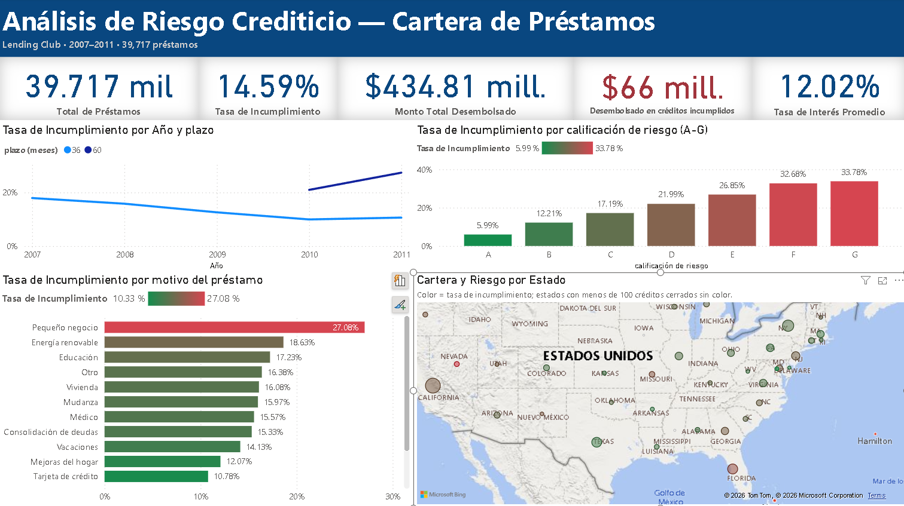

# Análisis de riesgo crediticio: cartera de préstamos

**Pregunta de negocio:** ¿qué segmentos de la cartera concentran el mayor riesgo de incumplimiento y dónde debería actuar primero el área de riesgos?

**Herramientas:** Python · Pandas · Power BI · DAX · Power Query

[Video del dashboard con explicación (3 min)](dashboard_demo.mp4)

## Resultado

| Indicador | Valor |
|---|---|
| Préstamos | 39,717 |
| Monto desembolsado | USD 434.8 millones |
| Tasa de incumplimiento (créditos cerrados) | 14.59% |
| Desembolsado en créditos incumplidos | USD 66.1 millones (15.9% de lo desembolsado en créditos cerrados) |
| Tasa de interés promedio | 12.02% |

- **La calificación de riesgo discrimina bien:** el incumplimiento sube de forma ordenada de 6.0% en la calificación A a 33.8% en la G.
- **El aumento de la mora en 2010–2011 es un efecto de composición, no un deterioro de la cartera.** A 36 meses, el incumplimiento bajó de 17.9% (2007) a 9.9% (2010) y 10.6% (2011). La subida agregada se explica por los préstamos a 60 meses, que se empezaron a otorgar en 2010, llegaron al 35% de las colocaciones de 2011 e incumplen mucho más (21.0% en 2010 y 27.4% en 2011).
- **Pequeños negocios es el motivo más riesgoso:** 27.1% de incumplimiento, casi el doble del promedio.
- **Florida combina volumen y riesgo:** concentra el 7.2% de la cartera con 18.1% de incumplimiento, frente a 11.9% en Texas, con un volumen similar. Nevada tiene la tasa más alta (22.5%).

**Prioridades sugeridas:** revisar la política de préstamos a 60 meses, los créditos a pequeños negocios y la exposición en Florida.

## Datos

[Lending Club Loan Dataset 2007–2011 (Kaggle)](https://www.kaggle.com/datasets/imsparsh/lending-club-loan-dataset-2007-2011): 39,717 préstamos originados entre junio de 2007 y diciembre de 2011, con 111 variables. El archivo original no se incluye en este repositorio.

## Método

1. **Limpieza en Python** ([`01_limpieza_datos.ipynb`](01_limpieza_datos.ipynb)): selección de 16 variables relevantes para riesgo, corrección de formatos (tasa de interés, plazo y fecha de desembolso), traducción del estado del crédito y etiquetado de la antigüedad laboral faltante.
2. **Definición de incumplimiento:** 1 para *Charged Off* y 0 para *Fully Paid*. Los 1,140 créditos vigentes quedan fuera de la tasa porque todavía no se conoce su resultado.
3. **Modelo en Power BI:** 5 medidas DAX (total de préstamos, tasa de incumplimiento, monto desembolsado, desembolsado en créditos incumplidos y tasa de interés promedio) y traducción de los motivos del préstamo en Power Query.
4. **Visualización:** tasa de incumplimiento por año de originación y plazo, por calificación, por motivo y por estado.

## Decisiones de análisis

- **Separar por plazo:** la tasa agregada por año mezcla dos productos con riesgos muy distintos y lleva a una conclusión equivocada.
- **Umbral mínimo por estado:** en el mapa solo se colorean los estados con al menos 100 créditos cerrados. Con menos casos, el intervalo de confianza es demasiado amplio. Por ejemplo, Nebraska tiene 3 incumplimientos en 5 créditos (60%), con un intervalo al 95% de 15% a 95%.
- **Monto incumplido, no pérdida:** los USD 66.1 millones son lo desembolsado a créditos que terminaron en incumplimiento. La pérdida real es menor, porque esos clientes pagaron parte del crédito antes de incumplir.

## Limitaciones

- La tasa por año se mide sobre créditos cerrados. En 2011 se excluyen los 1,140 créditos vigentes, todos a 60 meses, lo que puede sobrestimar la tasa de ese año.
- Es una tasa por año de originación, no un análisis de cosechas mes a mes.
- Pocos préstamos en 2007 (251), por lo que la tasa de ese año es menos precisa.

## Cómo reproducirlo

1. Descarga `loan.csv` desde Kaggle y colócalo en `data/`.
2. Ejecuta `01_limpieza_datos.ipynb`, que genera `data/loan_limpio.csv`.
3. Abre `Dashboard_Riesgo.pbix` en Power BI Desktop y actualiza la ruta del origen de datos en Power Query.
